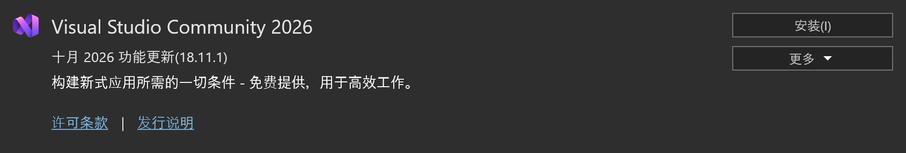
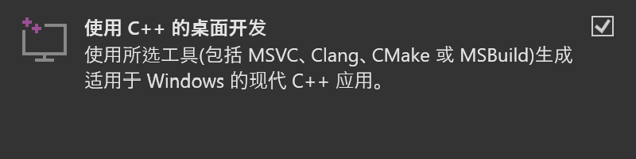
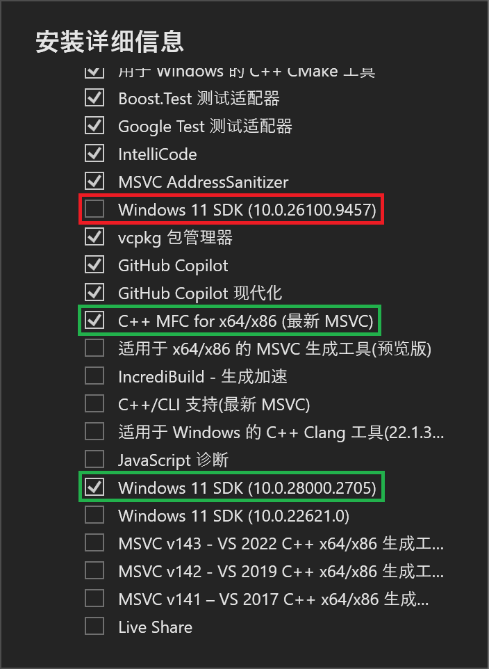
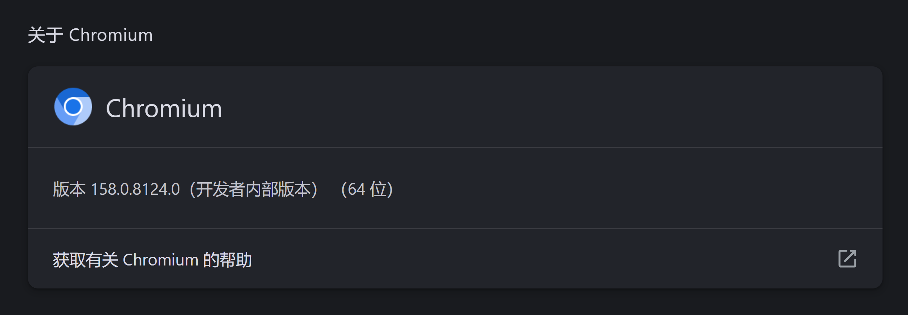

作为一名四年 OIer 怎能不来试试基于 C++ 的 Chromium 编译呢😋

本蒟蒻这里只写了 Windows 的教程，虽说我 Win/Mac/Linux 电脑都有，

但是性能还是我 Windows 电脑好

教程部分内容来自 [Chromium Docs - Checking out and Building Chromium for Windows](https://chromium.googlesource.com/chromium/src/+/main/docs/windows_build_instructions.md)

## 准备工作

### 检查系统配置

编译 Chromium 的最低硬件配置要求：

* 一台 64 位，有至少 8GB 内存的机器
* 有至少 100GB 剩余空间，以 NTFS 为文件系统的硬盘

听起来好像还可以？然而：

* 你就算有 64GB 内存对于编译 Chromium 也不算性能过剩
* 你最好有 200GB+ 的存储空间，最好是 SSD 可以更快

编译 Chromium 的软件要求：

* Windows 10/11
* Visual Studio 2026
* Git

这些都是 Chromium 最新版（截止最后编辑时间）的要求，
编译老版本可能对系统要求有所降低，这里我们只讲述最新版的

这里也放一下本人配置：

* 2TB SSD 存储空间
* 32GB 内存
* Windows 11

### 安装软件

#### Visual Studio 2026

> [!WARNING]
> 本部分将占用共计 16.56GB ,
> 
> 即使安装在 C 盘也需要占据 C 盘 3.71GB
>
> 还请提前清理空间

[点我前往 VS 官网下载](https://visualstudio.microsoft.com/)

会下载 Visual Studio Installer

到 `可用` 里选版本，选 社区版 `Visual Studio Community 2026` 就行了



点 `安装(I)` 之后，工作负荷选 `使用 C++ 的桌面开发`



转到右侧的`安装详细信息`,要作如下调整：



然后`安装(I)`即可。

> [!NOTE]
> 
> 如果你更改了安装路径，请记住它

安装需要时间，可以先进行下一步。

#### Git

什么? 你没安装 Git ? 不会吧......如果这是真的，你不适合编译 Chromium 

如果你执意要编译，那就请自行上网找 Git 安装教程，这里不再赘述

如果你已经安装了 Git ，也请你升级到最新版本

```cmd
git version
```

| 版本 | 更新方法 |
|---|---|
| `<=2.14.1` | 手动卸载再重装 |
| `2.14.2 - 2.16.1` | `git update` |
| `>=2.16.1(2)` | `git update-git-for-windows` |

键入以下命令

```cmd
git config --global user.name "名称"
git config --global user.email "电子邮箱地址"
git config --global core.autocrlf false
git config --global core.filemode false
git config --global core.preloadindex true
git config --global core.fscache true

REM 可选但建议
git config --global branch.autosetuprebase always
```

> 用户名和电子邮箱地址最好都和 GitHub 保持一致

同时，我非常建议你去配置一下梯子:

```cmd
git config --global http.proxy http://127.0.0.1:7890
git config --global https.proxy http://127.0.0.1:7890
```

#### depot_tools

键入以下命令

```cmd
REM 最好能在磁盘根目录下执行此命令，例如安装到 D:/depot_tools 如下操作
d:
git clone https://chromium.googlesource.com/chromium/tools/depot_tools.git
```

### 配置环境变量

配置以下环境变量

| 键 | 操作 |
|---|---|
| `DEPOT_TOOLS_WIN_TOOLCHAIN` | 赋值为 `0` |
| `vs2026_install` | 赋值为 你的 VS 安装路径 |
| `PATH` | 添加 depot_tools 路径并**上移至顶部** |

> VS安装路径若没有更改，默认是
>
> `C:\Program Files (x86)\Microsoft Visual Studio\18\Community`

### 配置其他工具

键入以下命令

```cmd
REM 最好配置一下梯子
set HTTP_PROXY=http://127.0.0.1:7890
set HTTPS_PROXY=http://127.0.0.1:7890

gclient
```

然后等待，直到输出帮助:

```txt
Usage: gclient.py <command> [options]

Meta checkout dependency manager for Git.

Commands are:
  config       creates a .gclient file in the current directory
  diff         displays local diff for every dependencies
  fetch        fetches upstream commits for all modules
  flatten      flattens the solutions into a single DEPS file
  getconfig    gets config values from the .gclient file
  getdep       gets revision information and variable values from a DEPS file
  gitmodules   adds or updates Git Submodules based on the contents of the DEPS file
  grep         greps through git repos managed by gclient
  help         prints list of commands or help for a specific command
  installhooks installs gclient git hooks
  metrics      reports, and optionally modifies, the status of metric collection
  pack         generates a patch which can be applied at the root of the tree
  recurse      operates [command args ...] on all the dependencies
  revert       reverts all modifications in every dependencies
  revinfo      outputs revision info mapping for the client and its dependencies
  root         outputs the solution root (or current dir if there isn't one)
  runhooks     runs hooks for files that have been modified in the local working copy
  setdep       modifies dependency revisions and variable values in a DEPS file
  status       shows modification status for every dependencies
  sync         checkout/update all modules
  validate     validates the .gclient and DEPS syntax
  verify       verifies the DEPS file deps are only from allowed_hosts

Options:
  --version             show program's version number and exit
  -h, --help            show this help message and exit
  -j JOBS, --jobs=JOBS  Specify how many SCM commands can run in parallel;
                        defaults to 16 on this machine
  -v, --verbose         Produces additional output for diagnostics. Can be
                        used up to three times for more logging info.
  --gclientfile=CONFIG_FILENAME
                        Specify an alternate .gclient file
  --spec=SPEC           create a gclient file containing the provided string.
                        Due to Cygwin/Python brokenness, it can't contain any
                        newlines.
  --no-nag-max          Ignored for backwards compatibility.
  --trace               Enable tracing to Chrome Trace Event format for
                        Perfetto UI.
  --trace-file=TRACE_FILE
                        Specify output file path for trace JSON (implies
                        --trace).
```

## 拉取代码

键入以下命令

```cmd
REM 最好配置一下梯子
set HTTP_PROXY=http://127.0.0.1:7890
set HTTPS_PROXY=http://127.0.0.1:7890

REM 最好能在磁盘根目录下执行此命令，例如拉取到 E:/chromium/ 如下操作
e:
mkdir chromium && cd chromium

REM 现在你有三个选择，分别是:

REM 直接拉取
fetch chromium

REM 直接拉取但不拉取 Git 历史记录
fetch --no-history chromium

REM 通过共享的快照快速拉取切保留 Git 历史记录 (本人做法)
REM 切记下面这个=后面的路径一定要用正斜杠，不要用反斜杠
set GIT_CACHE_PATH=E:/git-cache
fetch --git-cache chromium
```

一个字，**等**

成功后进入`src`文件夹，后续工作都将在该文件夹中进行

```cmd
cd src
```

## 编译

键入以下命令

```cmd
gn gen out\Default

REM 你可以更换 Default 文件夹名，
REM 但是这个文件夹必须是 out 文件夹下的子文件夹
```

输出

```txt
Done. Made 36728 targets from 5102 files in 18049ms
```

打开 `out\Defualt` 下的 `args.gn` ，并编辑: 

```gn
# Set build arguments here. See `gn help buildargs`.

# 如果一行前有#号就是注释，不启用；要启用就删去开头的#号

is_component_build = true # 这会使用更多更小的DLL，避免每次更改后都重新链接chrome.dll（推荐）
# target_cpu = "x86" # x86 构建可能比 x64 构建稍快（不推荐）
blink_symbol_level = 0 # 关闭 blink 的源码级调试以减少构建时间（推荐）
v8_symbol_level = 0 # 关闭 v8 的源码级调试以减少构建时间（推荐）
```

开始编译: 

```cmd
autoninja -C out\Default chrome
```

还是一个字，**等**

编译成功输出

```txt
build finished
noexec:420 local:57370 remote:0 cache:0 skip:39394
  cache-write:0(err:0) fallback:0 retry:0
fs: ops: 905945(err:134607) / r:243970(err:0) 74.08GiB / w:3726(err:0) 58.73MiB
  resource/capa used(err)  wait-avg |   s m |  serv-avg |   s m |
   localexec/16  49238(0) 33m06.19s |▂▂▂▂▂▃█|     4.47s | ▂▃█▃▂ |
 pool=action/16   7519(0)  1m51.30s |▇▂▄▃▃█ |     2.47s |  ▅█▂▂ |
    pool=link/3    613(0)     1.19s |█▂▂▂▂  |     1.64s |  █▅▂▂ |

3h51m29.12s Build Succeeded: 57790 steps - 4.16/s
```

## 运行 Chromium

打开`out/Default/chrome.exe`即可




恭喜你，完成了本地编译 Chromium 这一壮举！

## 后记

感觉也没有想网上说的那么难啊，就是有点吃配置罢了🤔

另外编译的时候如果时间晚就快去睡觉，不要闲着没事在那干等着，熬死你😰

我后面其实还试过自己改，但是 Google 官方 tm 一天几百个提交😭

就算我 merge 了我可能都不知道我改的哪里被冲掉了，溜了溜了🏃‍♂️